## About me

Cloud & DevOps Engineer with 14+ years in IT, specializing in multi-cloud environments (OCI, AWS, Azure, GCP) and production-grade platform engineering. Background in consulting and outsourcing — managing multi-client environments with strict DEV/PRD segregation and 24/7 critical operations. Proven track record as Technical Supervisor, Tech Lead and Project Manager with **70+ projects delivered**. Strong focus on root-cause analysis, infrastructure reliability and FinOps.

---

## Tech Stack

**Cloud**

**Containers & Orchestration**

**IaC & Automation**

**CI/CD & GitOps**

**Networking & Security**

**Observability**

**Databases**

**OS & Runtimes**

**Dev**

---

## Certifications

---

## Currently

- Building and operating a production Kubernetes platform on OKE (Oracle Cloud) — multi-environment, GitOps-driven
- Strengthening observability pipelines and root-cause analysis practices for critical workloads
- Developing personal projects in Go + React

---

**[LinkedIn](https://www.linkedin.com/in/brunodelima1/)** · **br7delima@gmail.com** · 📍 Ponta Grossa, PR — Brazil

